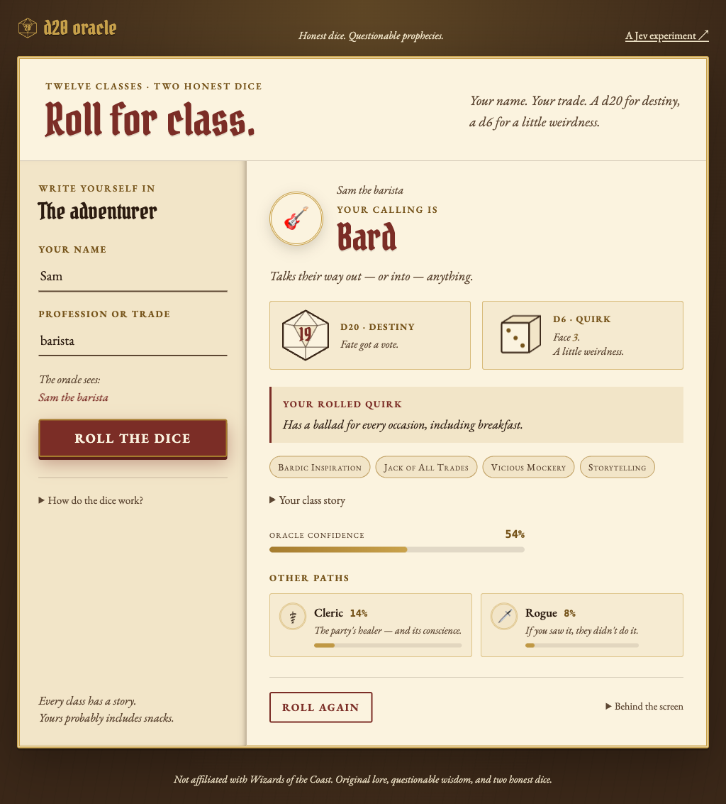

# d20-oracle

A one-page Go demo for [TypeSafe's Jev](https://docs.typesafe.ai): type a name
and profession, roll a d20 for destiny and a d6 for a little weirdness, and get
your Dungeons & Dragons 5e class.



## Overview

The server sends the identity and d20 roll to Jev as one **choice** question
over the twelve core 5e classes. Jev scores all twelve; the highest-probability
class wins, and up to two runners-up appear as close calls. A local d6 then
picks one of six original quirks for the winner.

The page is a two-panel character folio: the adventurer on the left, the
reading on the right. The binary embeds the HTML, CSS, and JS. HTMX 4 swaps in
the reading, Alpine.js keeps the name/profession echo live, and Open Props
supplies design tokens. Those vendor libraries load from pinned unpkg URLs with
SRI hashes. No database, no frontend build step.

**Stack:** Go 1.27 stdlib (`net/http`, `html/template`), a typed Jev System One
client with retry and backoff, an embedded frontend, a scratch Docker image,
and GitHub Actions CI.

## Run

Requires [mise](https://mise.jdx.dev/) and a
[TypeSafe API key](https://console.typesafe.ai/settings/keys).

```sh
mise install
cp .env.example .env      # paste your key
mise run build            # produces ./d20-oracle
./d20-oracle -addr :8080  # open http://localhost:8080
```

`TYPESAFE_API_KEY` is the only required configuration; `-addr` defaults to
`:8080`. A `.env` in the working directory or next to the binary fills in
whatever is unset, and the environment always wins. Without a usable key the
page and `/health` still serve, but `/api/class` answers 503 and never contacts
TypeSafe. Blank or whitespace-only values count as unset.

The Jev deadline is 15 seconds, with two HTTP attempts (7 seconds each) and
backoff on 429/529.

### Docker

```sh
docker build -t d20-oracle .
docker run --rm --env-file .env -p 8080:8080 d20-oracle
```

The image is `scratch` plus the static binary, `LICENSE`, and a CA bundle for
the Jev HTTPS API. It runs as `65532:65532` and supports `--read-only`. Use
plain `KEY=value` lines in Docker's `--env-file` (no shell quotes). For
cross-builds pass `--platform` (Cloud Run requires `linux/amd64`).

## How it works

```text
POST /api/class
  → roll d20
  → Jev: one choice question over 12 classes
  → highest probability wins + up to 2 runners-up
  → roll d6 locally → class-specific quirk
  → HTML partial or JSON
```

- **d20 · Destiny** — a uniform 1–20 from `crypto/rand`, sent to Jev as a
  narrative hint. 20 favors a legendary expression of a fitting class; 1
  favors a chaotic but plausible fit; middling rolls let name and profession
  lead. It is not a numerical modifier: a clear match can win on any roll.
- **d6 · Quirk** — an independent uniform 1–6 from `crypto/rand` that selects
  one of six original quirks for the winning class. It is a local lookup; each
  reading makes one Jev decision (with bounded retries).

Runner-ups appear when their displayed probability rounds to at least 1%;
otherwise the oracle sees one path.

## API

- `GET /` — the page.
- `POST /api/class` — `name=...&profession=...` (form) or
  `{"name":"...","profession":"..."}` (JSON). Returns an HTML partial for
  HTMX, a full page for native form posts, and JSON with `?format=json` or
  `Accept: application/json`. `roll` is the d20, `quirk_roll` is the d6, and
  `quirk` is the selected class-specific flavor. Returns 503 when
  `TYPESAFE_API_KEY` is missing, without contacting TypeSafe.
- `GET /health` — `ok`. It stays 200 without a key, because the page is still
  served.

```sh
curl -s 'http://localhost:8080/api/class?format=json' \
  -d 'name=Sam&profession=barista'
```

## Deploy

The Dockerfile deploys to Cloud Run; `min-instances=0` scales to zero when
idle. Set `PROJECT_NUMBER` for the command below. One-time setup per project:
enable billing and the Cloud Run, Cloud Build, Artifact Registry, and Secret
Manager APIs; create the `typesafe-api-key` secret; grant the runtime service
account `roles/secretmanager.secretAccessor`.

```sh
gcloud run deploy d20-oracle \
  --source=. \
  --region=us-central1 \
  --allow-unauthenticated \
  --service-account="${PROJECT_NUMBER}-compute@developer.gserviceaccount.com" \
  --set-secrets=TYPESAFE_API_KEY=typesafe-api-key:latest \
  --min-instances=0 --max-instances=2 --memory=256Mi --cpu=1 \
  --timeout=60s --concurrency=40
```

Cloud Run intercepts some paths ending in `z` (including `/healthz`), which is
why the app exposes `/health`.

## Develop

```sh
mise run fmt       # gofmt
mise run lint      # golangci-lint
mise run test      # go test -race ./...
mise run coverage  # print total statement coverage
mise run build     # single-binary build
```

CI runs these gates plus native and Docker smoke tests on `main` pushes and
pull requests. The smoke checks include the keyless 503 path.

## License

MIT — see [LICENSE](LICENSE).

Unaffiliated fan toy: D&D is a trademark of Wizards of the Coast. No official
art, symbols, or rules text is used — the crests are emoji and the lore is
original.
